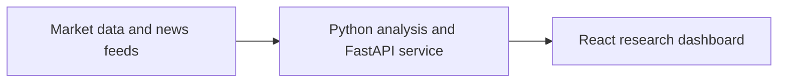

# Future Growth Stock Analyzer

## Architecture

A research dashboard that brings market observations and AI-assisted checklists together.

### Follow one interaction

Select a company or theme. The backend collects observations and calculates indicators; the dashboard presents those results alongside the research checklist.

## APIs and interfaces

| Connection | What crosses it |
| --- | --- |
| Frontend → Python backend | The React client calls FastAPI for research views and calculated indicators. |
| Backend → market and AI providers | Separate services gather financial data and prepare Gemini-assisted checklists. The distinction between observations and generated analysis matters when reading a result. |

### Why it works this way

Market observations can age and external services can fail. Separating collection, analysis and display makes it possible to inspect the inputs behind an interpretation.

## Source in this repository

Read [technical_analysis.py](technical_analysis.py) to see how Python turns a series of market prices into indicators using pandas and NumPy. This is an excerpt from the original app.

[Back to the project index](https://github.com/IT-Yun/IT-Yun)
